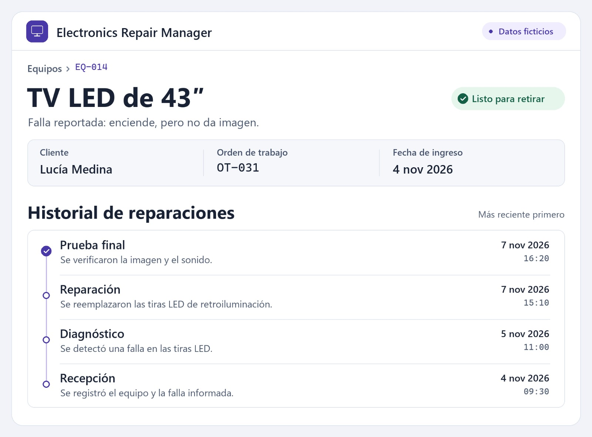
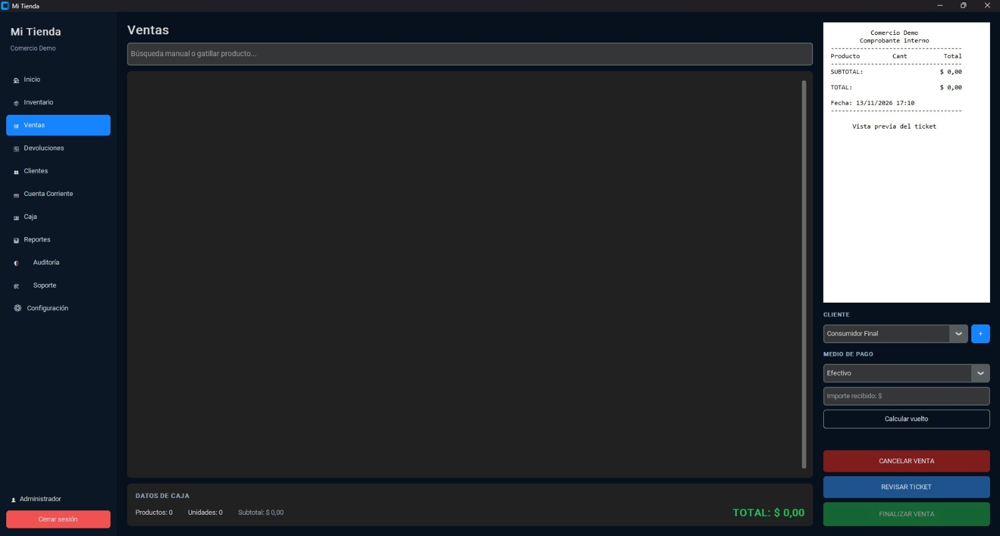
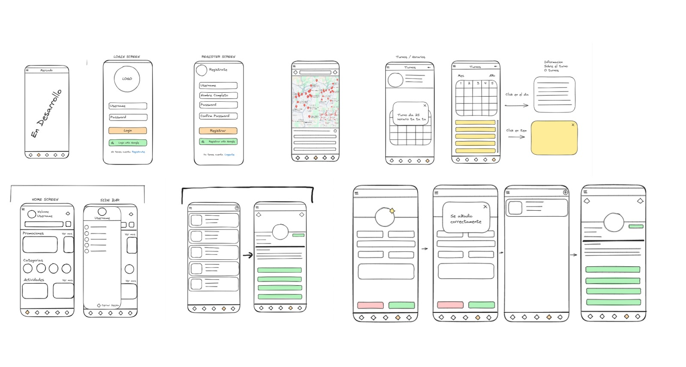

# Hi, I'm Elian Baque

**Python Backend Developer · Django REST Framework · PostgreSQL**

At MobyDigital, I developed REST APIs and an API gateway. For Magnify, I used NumPy and pandas to reduce a data-loading bottleneck involving 360,000 records.

## Selected projects

### Electronics Repair Manager

A web app for electronics repair shops. I'm building it to give technicians one place to look up customer records and repair histories instead of searching paper records or WhatsApp chats. I plan to add income and expense reports that adjust historical amounts for cumulative inflation in Argentina.

**Stack:** React, Django, PostgreSQL, Docker.

[Frontend repository](https://github.com/EliFBaque/electronic-managment) · Private backend

**Design concept**

Fictional data showing a TV repair from intake through final testing.

### Inventory and Invoicing Desktop App

I'm building a desktop inventory app for a client with Python and CustomTkinter. The invoicing workflow is designed to integrate with Argentina's ARCA electronic invoicing system.

**Sales screen · Demo data**

### Hospital Mobile App

An early concept for a mobile app that helps patients manage appointments. The project has an initial codebase built with React Native, Django REST Framework, PostgreSQL, and Docker.

**Design concept**

## Tech stack

- **Backend:** Python, Django, Django REST Framework, REST APIs
- **Data:** SQL, PostgreSQL, SQLite, NumPy, pandas
- **Desktop UI:** CustomTkinter
- **Testing:** pytest
- **Tools:** Docker, Git, pgAdmin, Postman

[LinkedIn](https://www.linkedin.com/in/elianbaque/)
